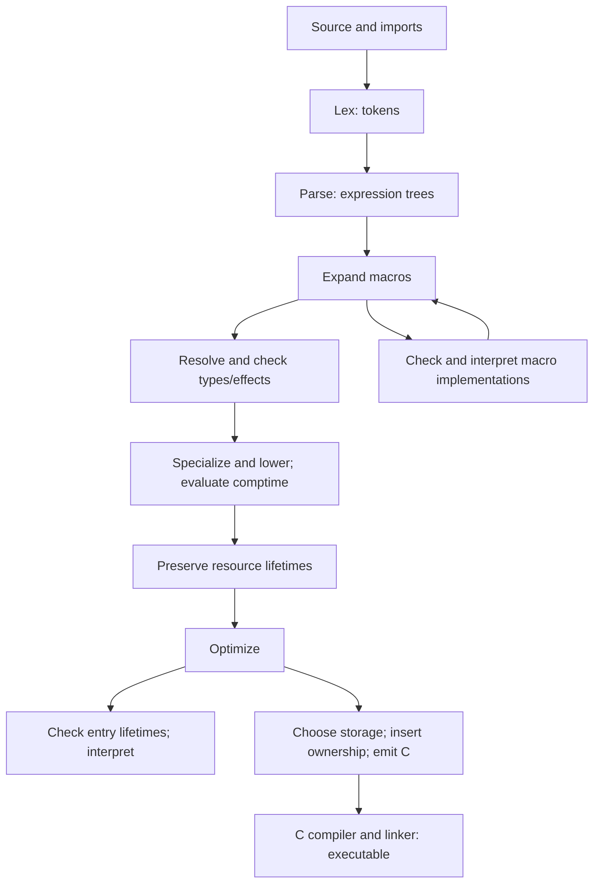

# From source text to a running program

This guide describes the implemented compiler. Start with the
[language reference](reference.md) for syntax and [lesson 11](tutorials/11-comptime-and-macros/README.md)
for a runnable macro example. An **AST** is a tree of source expressions; an
**IR** is the simpler internal program used for optimization and execution.

## Compilation order



The arrows show stage order; the table identifies the responsible source files.

| Stage | Input → output | Implementation |
|---|---|---|
| Load | Main file, imports and bundled library → source modules | `src/driver.rs` |
| Lex | Characters → tokens with source positions | `src/lexer.rs` |
| Parse | Tokens → declarations and expression trees | `src/parser.rs`, `src/ast.rs` |
| Expand macros | Parsed expression calls → replacement expression trees; repeat as needed | `src/macros.rs`, `src/syntax.rs` |
| Resolve declarations | Expanded modules → names, types, traits, implementations and exports | `src/env.rs` |
| Infer and check | Expressions → ordinary types, effects, resource checks and resolved calls | `src/infer.rs`, `src/types.rs` |
| Specialize and lower | Reachable concrete uses → typed IR; evaluate `comptime` expressions | `src/mono.rs`, `src/ir.rs` |
| Preserve resources | Record original resource scopes before transformations | `src/resource.rs` |
| Optimize | Matrix specialization → pure-constructor proof → simplification/inlining → known callback specialization → fusion → self-tail proof | `src/fuse.rs`, `src/opt.rs`, `src/opt/stages.rs`, `src/tailrec.rs` |
| Interpret | Check entry lifetimes, then execute typed IR directly | `src/arc.rs`, `src/arc_scope.rs`, `src/interp.rs` |
| Or generate native code | Select representations, prove direct-call borrows, insert and verify reference operations, check ownership for default ARC execution, emit C/runtime | `src/cgen.rs`, `src/rc/borrows.rs`, `src/rc.rs`, `src/ownership.rs` |
| Compile and link | Generated C and required libraries → native executable/library or supported WebAssembly module | C toolchain, selected by `src/cgen.rs` |

Macro expansion has its own nested check/lower/interpret cycle: macro functions
must themselves be compiled before they can generate the final program. Thus
“macros run before type checking” means before checking the final expanded user
program, not that macro implementations are untyped.

Self-tail analysis follows fusion, before native reference-count insertion.
It marks eligible functions without changing their expression trees: native
representation selection still sees their original record/variant fields and
wide-number operations. Both backends reuse the marked frame only for direct
self calls in tail position, after preparing all next arguments. Other recursive
calls in the same function keep ordinary frames. [The recursion contract](design.md#tail-calls-and-recursion)
explains eligibility, preserved cleanup and the raw/debugger exceptions.

Setting `FWP_NO_OPT=1` skips the optimization stages listed above; it does not skip
parsing, expansion, type checking, lowering or resource preservation. Native
ownership lowering is separate. Unset `FWP_NO_OPT` to enable optimization:
its presence disables the passes, even with a value of `0`. Debug builds also validate local types after
passes and check inserted reference operations.

The interpreter uses Rust-owned
values rather than executing the generated C reference-count machinery.
Public interpreter entries now check queue/State/autodiff lifetimes before
language effects, using the same proof as native ARC. Successful checks are
cached per entry in the immutable program; unreachable definitions are not roots.

This entry check passed [G5 verification](roadmap-history.md#tracing-gc-removal-pr-217).
Direct-call borrowing changes who keeps an argument alive during a call, without
changing its source type. Its proof runs before reference operations are inserted;
[the ownership design](design.md#ownership-implementation) explains the limits.
Before either step, `src/cgen/scalar_text.rs` removes eligible temporary integer
displays used only by printing or character counting.

It preserves the scalar
inputs and their evaluation order; [the text lowering rules](design.md#measuring-integer-text-without-building-it)
explain which expressions qualify.

## What kind of parser is this?

fwp has a **hand-written, top-down recursive-descent parser** with a separate
lexer, a column-based layout rule, and **precedence climbing** for infix
arithmetic and comparisons. Recursive descent means Rust functions recognize language constructs
by calling functions for their smaller parts. Precedence climbing decides which
operator binds its operands first.

| Classification | How it applies |
|---|---|
| Predictive / LL-style | Reads left to right and selects constructs using the next tokens. `peek_at(1)` and `peek_at(2)` distinguish some declarations. |
| Not a claimed LL(1) grammar | The implementation uses more than one token of lookahead and auxiliary layout/declaration state. No formal FIRST/FOLLOW proof or complete LL(k) grammar is maintained. |
| Not LR/LALR | There are no generated shift/reduce tables. Those are bottom-up parsing methods. |
| Not PEG/packrat | Successful parsing does not explore competing alternatives by backtracking, and there is no memoized parsing table. |
| Precedence climbing, not a general Pratt framework | Operators recurse with a minimum precedence; calls and atoms use dedicated functions rather than per-token prefix/infix handlers. |
| Layout-sensitive | Token columns and line starts delimit selected blocks. No lexer-generated INDENT/DEDENT tokens are used. |

In LL terminology, the first L means reading left to right and the second means
constructing a leftmost derivation: expand the leftmost unfinished grammar rule.
The number in LL(k) is the allowed token lookahead. FIRST/FOLLOW sets describe
which tokens can begin a rule or follow it; proving their required separations
would be part of a formal predictive-grammar argument.

LR instead constructs a
rightmost derivation in reverse, combining recognized pieces from the bottom up.
PEGs use prioritized alternatives; packrat is a memoized implementation technique.
Their absence here is a description of the code, not a claim that those parser
families could not express fwp.

The expression core can be described by a context-free grammar. The complete
implementation also compares columns and validates things such as duplicate
fields; calling the whole frontend “a context-free grammar” would omit those
rules. The categories above describe the algorithm, not a proof of the formal
language's place in the Chomsky hierarchy. Type inference is a later stage.

For the parsing techniques, see [LLVM's recursive-descent tutorial](https://llvm.org/docs/tutorial/MyFirstLanguageFrontend/LangImpl02.html)
and [Norvell's precedence-climbing explanation](https://www.engr.mun.ca/~theo/Misc/exp_parsing.htm).

## Tokens, layout and precedence

The lexer separates names, literals, selectors and punctuation. It keeps decimal
float text until the destination type is known, avoiding early F64 rounding.
Comments are available to formatting tools. Each token records its line, column
and whether it is the first token on that line.

Top-level declarations start in column one. Indented lines continue a declaration;
`match`, `trait` and `impl` introduce blocks at their first item's column. A new
line at or left of the active block boundary ends the current expression.
Parentheses, lists and explicit braces suspend that outer layout boundary.
Indentation does not introduce arbitrary function-argument groups.

For example, these are the same pipeline:

```fwp
long-word = string.length | gt 3

long-word-again =
    string.length
    | gt 3
```

The expression parser follows this simplified structure; it is not the complete
grammar for patterns, declarations, types or `comptime`:

```text
expression   := operators ("|" operators)*
operators    := application followed by operators at the allowed precedence
application  := atom atom* | "-" application
atom         := name | literal | selector | grouped expression | collection
                | match | quote | "fn" pattern "->" expression
                | "let" pattern "=" expression "in" expression
                | other fixed keyword forms
```

| Tightest to loosest | Association |
|---|---|
| Calls: `f x y` | Successive application: `(f x) y` |
| Unary negation: `-x` | Prefix; calls bind inside it |
| `* / %` | Left |
| `+ -` | Left |
| `== != < <= > >=` | Parentheses required for successive comparisons |
| Pipe: `a \| b` | Left |

Symbolic arithmetic is infix: `2 + 3 * 4`, not `+ 2 * 3 4`. Named functions
such as `add 2 | mul 3` use ordinary application and pipes; they add no second
operator grammar. The [parser workspace benchmark](parser-workspace.md) consumes
a quoted text format of its own, separate from fwp source syntax.

`2 + 3 * 4 | echo` groups as `(2 + (3 * 4)) | echo` and prints `14`.
`20 - 6 - 2` groups as `(20 - 6) - 2` and gives `12`. In
`operator_expr(min_precedence)`, the right operand uses `precedence + 1`; that is
what makes equal-precedence arithmetic associate left.

At the comparison level,
a second comparison produces a diagnostic unless parentheses already grouped
an operand. Thus `1 + 2 == 3 | echo` prints `True`, but `1 < 2 < 3` is rejected.
This adds a fixed precedence level and six tokens; no backtracking or type-driven
parsing is introduced.

Lexical distinctions matter before precedence: `count-long` is one name,
`add -1` supplies a negative literal, `x -1` is application, and `x - 1` is
subtraction. The lexer recognizes `name!(` as a macro-call token including its
opening parenthesis. Macros receive already parsed arguments; they do not extend
the token grammar or introduce new operators.

`fn`, `let` and `in` are reserved tokens. Their fixed delimiters keep parsing
predictive: `in` ends the initializer; the body uses the ordinary expression
parser. Nested lets consume their own `in` first. No symbol table, type query,
backtracking or new arithmetic precedence level is needed.

A named pattern is
recognized by its lowercase token; constructors retain uppercase tokens.
Duplicate names and refutable fn/let patterns are rejected. The type checker
repeats these admission rules for macro-generated trees, which bypass parsing. The
formatter keeps successive `in let` clauses aligned and consecutive `fn` inputs
on one line when they fit; it preserves written record-field shorthand.

## Where desugaring happens

**Desugaring** turns convenient syntax into ordinary language operations. fwp
does this at several stages, not in one universal desugaring pass.

| Source form | Implemented treatment |
|---|---|
| Parenthesized expression | Parser returns its inner AST; tuples/unit remain distinct forms. |
| `a - b` | Parser builds an operator node around `flip sub`, with `a` then `b` as operands. This preserves left-to-right evaluation despite data-last `sub`. |
| Arithmetic and comparison notation | Retained in the AST for formatting/quoting; inference and lowering use ordinary trait operations. |
| `a \| b` | Parsed as a pipe node. Inference decides application versus composition from types; syntax parsing does not guess the function's type. |
| `.name`, `make`, `update`, `match`, tuples and lists | Kept as source forms, checked, then lowered to field access, calls, records, constructors and branches. |
| `name!(...)` | Macro expansion substitutes an expression AST before final program checking. |
| `comptime e` | The checked expression runs in the interpreter during specialization/lowering; its result becomes an IR constant. |
| `{ x }` | Parser expands the field to `x = x`; no implicit input is introduced. |
| `let pattern = value in body` | Inference assigns lexical binding identities; lowering evaluates the value once, then binds a local or destructures an irrefutable match. |
| `fn pattern -> body` and named match arms | Lowering creates a function with explicit capture parameters followed by its single source input. A simple fn name uses that input slot directly; no wrapper match or alias is emitted. Destructuring uses typed patterns. |
| Generic calls | Concrete used types select specialized functions and trait methods. |

`a - b` is not rewritten to `sub b a` by swapping unevaluated expressions: that
could reverse effects or failures. Likewise, `map f | sum` is not syntax sugar
for a loop. Combining those stages is a later optimization requiring a proof
that it preserves behavior.

## Errors and complexity

`parse_module_recover` reports declaration errors and resumes at a plausible
declaration starting in column one. This is boundary-based error recovery, not
backtracking to find a different successful parse. A lexical error stops that
file before parsing. `parse_module` returns the first reported syntax error.

Ordinary token traversal has linear behavior with fixed operator precedence;
tokens and AST nodes occupy memory proportional to source size. Do not claim a
proved linear bound for the entire parser: duplicate-field checks scan earlier
fields and can take quadratic work for a very large record. Nested constructs
also use the Rust call stack. Macro execution, type inference and specialization
have separate costs; the parser's traversal does not bound compilation time.

## Macros and compile-time values

Macros are implemented. The complete example is in
[lesson 11](tutorials/11-comptime-and-macros/README.md):

```fwp
macro twice = quote (unquote!(0) | unquote!(0))
add-two = twice!(add 1)
main = 40 | add-two | echo
```

`quote` builds syntax as data. In this template, `unquote!(0)` selects the first
syntax argument. Expansion produces `add 1 | add 1`, so the program prints `42`.
The macro receives the syntax `add 1`, not the result of calling it. Duplicating
syntax can duplicate runtime work and effects; `twice!` deliberately runs the
supplied function twice. Ordinary functions are preferable when syntax itself
does not need inspection or transformation.

The implementation:

1. Finds expression macro calls in the loaded modules.
2. Builds a phase program from macros and dependencies that no longer contain
   unresolved macro calls. Checks types and lowers that program.
3. Invokes outermost macros in the interpreter, passing `Syntax` values. Each
   argument and the result must have type `Syntax`; arity must match.
   It waits for child tasks before decoding the result. A failed invocation
   cancels and joins its children before reporting the error.
4. Decodes the result to an expression AST with fresh node IDs. Invalid syntax,
   macro failures and traps become diagnostics at the invocation.
5. Repeats when expansion creates more macro calls, then checks the final program.

The round guard reports unfinished expansion at 32 rounds. It is not a time or
instruction budget for a macro invocation; a nonterminating macro body is not
stopped by that guard. Macros replace expressions, not whole declarations or
imports. They cannot change precedence or bypass final type checking.

Quoted names that resolve in the definition module become fully qualified names.
Quoted lexical binders carry private identities and expansion assigns fresh
identities to introduced bindings. Spliced argument names retain their caller
spelling and are excluded from binder renaming. This prevents an introduced
`let x` from capturing the caller's unrelated `x`.

Manually constructing `SName`
values or unresolved quoted names still requests spelling-based resolution.
`SLet`, `SLambda`, `PName`, `PRecord` and `PIgnore` represent the added forms;
`PHole` retains match forwarding. A non-positional splice is evaluated once when the template is constructed;
its Syntax result becomes an explicit capture before the hole parameters.

Template
invocation supplies placeholders without repeating those computations. Hole
indices are integer literals 0–63. `SQuote` preserves a nested quote as syntax:
its placeholders and unquotes belong to that later evaluation stage. Hygiene
tracks separate binder scopes per quote, returning to the surrounding scope
inside an unquote.

`SOther` represents syntax through validated source text; decoding reparses it
with the same expression parser. `SFloat` carries decimal text rather than F64.

`comptime` is different: it computes an ordinary value, such as
`comptime (range 0 4 | map (mul 2))`, producing `[0, 2, 4, 6]` as a constant.
Its checked effects are limited to `IO`, `FileIO`, `Alloc` and `Error`; it cannot
use tasks or networking. File access is a compilation input, not a sandboxed
promise of reproducibility. That `comptime` effect check is not a blanket macro
sandbox: macro functions are invoked as ordinary interpreted functions, and the
expander has no separate equivalent effect allowlist.

The result must be data that can be embedded in the program. For example,
`text = comptime (file.read "message.txt")` embeds the file's text. Returning
`file.open "message.txt"` instead is rejected: its open handle belongs to the
compiler process and cannot survive into a separately compiled executable.
This restriction also applies to handles inside containers or function captures.

Useful entry points: `driver::check_source`, `macros::expand`, `Expander::invoke`,
`syntax::quote/from_value`, `mono::comptime` and `mono::lower`. Tests live in
`tests/parse/`, `tests/run/` and [lesson 11](tutorials/11-comptime-and-macros/README.md).
For representations, ownership and emitted code, continue with [compiler design](design.md).


## Interactive execution and machine-code inspection

The [REPL](repl.md) reuses checked definitions and evaluated values between
submissions. The [notebook](notebooks.md) uses that session through a JSON
protocol; neither introduces a JIT. The [debugger](debugging.md) instead lowers
an unoptimized program with source-expression markers for stepping and value
events. Those markers are absent from ordinary native builds.

The disassembler reads actual objects or executables using LLVM. Its Python
comparison API generates C for each explicit target and records the ordinary
counted ownership model. It then invokes the selected
C compiler at each requested optimization level. C debug line tables associate
instructions with generated source. They are not a one-to-one mapping after
optimization, and cross-target inspection is not native execution evidence.
