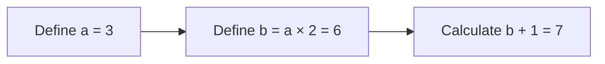
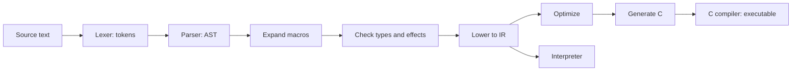
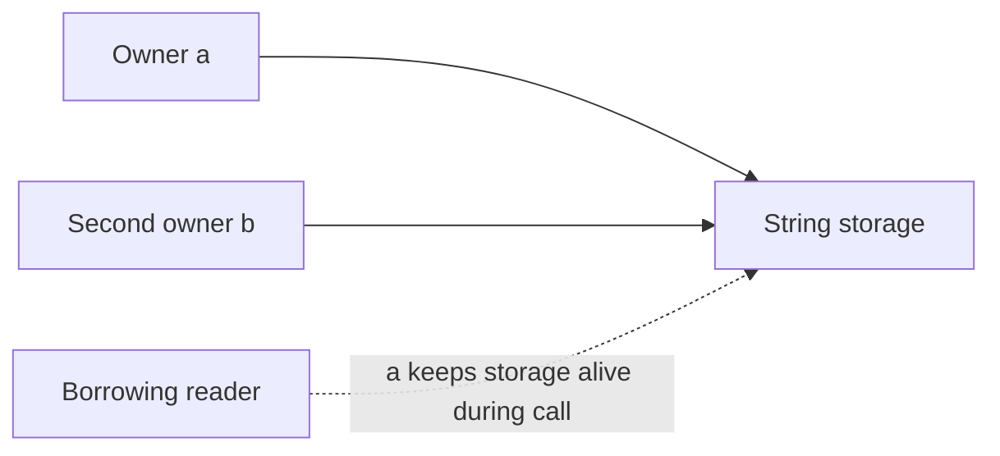
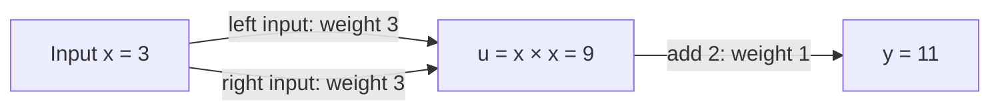

# Terminology

Start with an example, then look up the terms used in it:

- [Local names: `let … in …`](#local-names)
- [Pipes, functions and types](#pipes-functions-and-types)
- [Compilation and parsing](#compilation-and-parsing)
- [Memory and ownership](#memory-and-ownership)
- [Derivatives and tapes](#derivatives-and-tapes)
- [Networking and tools](#networking-and-tools)
- [Tests and measurements](#tests-and-measurements)

These definitions explain concepts. [Design limits](design-limits.md) state which
properties fwp actually guarantees. Tutorials introduce terms before using them.

## Local names

**`let … in …` is one expression. Each `let` has a matching `in`.**

```fwp
let x = 3 in x + x
```

| Part | Meaning |
|---|---|
| `let x = 3` | Evaluate `3` and give it the local name `x`. |
| `in` | End the definition; begin the expression using that name. |
| `x + x` | Calculate `6`, the value of the complete expression. |

`in` is a separator, not an output command or early return. For example:

```text
10 + (let x = 3 in x + x)
10 + (3 + 3)
10 + 6
16
```

### Several local definitions

```fwp
let a = 3
in let b = a * 2
in b + 1
```



- The first `in` belongs to `let a`; its body is the whole second `let`.
- The second `in` belongs to `let b`; its body is `b + 1`.
- There is no combined `in let` keyword. Read that pair as “then define.”
- `a` is available in the following calculation; `b` is available after its own `in`.

A pipe can express the same small example with an explicitly named function:

```fwp
let x = 3 in x + x
# Same result:
3 | (fn x -> x + x)
```

The pipe supplies `3`; `fn x` names that input; its body produces `6`.
OCaml and Haskell also use `let … in …`. Rust spells this example
`{ let x = 3; x + x }`; Clojure uses `(let [x 3] (+ x x))`.
Their broader evaluation and type rules differ.

| Term | Meaning / example |
|---|---|
| Binding | A name associated with a value: `x = 3` above. |
| Initializer / body | The expression producing the named value / the expression after `in`. |
| Lexical scope | Where a name is visible, determined by the enclosing source. |
| Strict evaluation | Evaluate the initializer once even if its name is unused; its failure still occurs. |
| Immutable | A binding cannot be assigned a different value. |
| Shadowing | Introduce a new name with the same spelling: `let x = 3 in let x = x + 1 in x` gives `4`. |
| Destructuring | Name pieces of one value: `fn (x, y) -> x + y` receives one tuple. |
| Irrefutable / refutable pattern | Always matches the known input type / can fail, as `Some x` can fail on `None`. Refutable cases use `match`. |

See [lesson 1](tutorials/01-pipes-and-functions/README.md) and
[the syntax reference](reference.md#local-bindings-and-named-functions).

## Pipes, functions and types

```fwp
double = mul 2
energy : I64 -> I64
energy = fn x -> let square = x * x in square + square
```

- `3 | double` gives `6`; `double` never names its input.
- `energy 3` gives `18`; the multiplication produces `9` once.
- Both functions take one argument. Named inputs and tacit pipes can coexist.

| Term | Meaning / example |
|---|---|
| Pipe | `x \| f` supplies `x` to `f`; `f \| g` composes functions in that order. |
| Data-last | Configuration comes first: `10 \| sub 3` means `10 - 3`. |
| Tacit | Combine functions without naming their input: `double = mul 2`. |
| Currying | Supply arguments one at a time; `add 3` returns a function awaiting another number. |
| Partial application / saturation | Supply fewer arguments than an entry needs / supply its complete argument list. |
| Combinator | Connect functions: `both length sum` returns both answers for one list. |
| Constant function | `const 7` ignores an input and returns `7`; `7` alone is a number. |
| Callback | A function passed to another operation: `mul 2` in `map (mul 2)`. |
| Closure / capture / environment | A function remembers surrounding values; those values are captures, and their storage is its environment. |
| Escaping | A value may be returned or stored beyond its creating call. |
| Unit | `()`: no meaningful input/result. It differs from the empty list `[]`. |
| Tuple / projection | `(3, "cat")` groups by position; `.0` selects `3`. Indices start at zero. |
| Record / field / shorthand | `{ age = 3 }` groups by name; `.age` selects it; `{ age }` means `{ age = age }`. |
| Variant / constructor / match arm | An alternative such as `Some value`; `Some` constructs it; an arm specifies what a matching case does. |
| Type / signature | `I64` describes values; `I64 -> I64` describes a function's input and result. |
| Inference / static checking | Deduce types from use / check them before execution. Dynamic checks such as overflow remain. |
| Strong typing | A String cannot be used as an integer without an explicit supported conversion. |
| Generic / polymorphic | Usable at multiple types; fwp requires an explicit generic signature. A local binding has one inferred type. |
| Trait / implementation | Required operations / their implementation for a type; `where Eq[a]` requires equality for `a`. |
| Structural / nominal | Identified by fields / also by a declared type name. Matching shapes alone need not make named types interchangeable. |
| Effect / handler | A tracked action, such as `IO` or `Error[String]` / the construct providing its behavior. |
| Pure | No declared external action; allocation, computation and traps can still occur. |
| State | Information carried between operations; `run-state` scopes the state used by `get`, `put` and `modify`. |
| Trap / unwind / cleanup | Stop on an invalid operation / leave interrupted calls / release their resources. A trap differs from a recoverable `Error` effect. |
| Cancellation | Stop a task whose result is no longer wanted, while completing required cleanup. |

A capture example: `let offset = 3 in fn x -> x + offset` returns a function that
remembers `3`. It returns `8` when called with `5`; separate heap storage is needed
only where the compiler cannot eliminate it safely.

## Compilation and parsing



For `2 + 3 * 4`:

1. The lexer finds `2`, `+`, `3`, `*`, `4`.
2. Precedence makes the tree `2 + (3 * 4)`.
3. The calculation produces `14`; constant folding may establish that before execution.

| Term | Meaning |
|---|---|
| Token / grammar | A source unit / rules for combining source units. |
| AST / IR | Abstract syntax tree reflecting source structure / intermediate representation used for optimization and execution. |
| Frontend / backend | Reads and checks source / produces target code. |
| Precedence / associativity | Which operators bind first / grouping at equal precedence: `20 - 6 - 2` means `(20 - 6) - 2`. |
| Recursive descent / lookahead | Parser routines recognize smaller constructs / inspect upcoming tokens before choosing a rule. |
| LL(k), FIRST, FOLLOW | Predictive parsing with `k` lookahead tokens; sets of tokens that can begin/follow rules. fwp is LL-style without a maintained LL(k) proof. |
| LR / LALR | Bottom-up parsing families using shift/reduce states; not fwp's implementation. |
| Precedence climbing / Pratt parsing | Related expression strategies; fwp uses precedence climbing with dedicated application/atom routines, not a general Pratt framework. |
| PEG / packrat / backtracking | Ordered grammar alternatives / memoized parsing / retrying alternatives. These do not describe fwp's successful parsing path. |
| Layout-sensitive | Line starts and columns delimit selected constructs; indentation does not replace `in`. |
| Desugaring / lowering | Expand convenient syntax / translate high-level operations to simpler internal operations. |
| Macro / quote / unquote | Compile-time syntax generation / represent syntax as a value / insert prepared syntax. |
| Hygiene | A macro's introduced name cannot accidentally capture a caller's same-named variable. |
| `comptime` | Evaluate a checked expression during compilation. |
| Specialization / monomorphization | Compile a generic function for a particular type. |
| Inlining / constant folding | Substitute a known function's operations / calculate known results during compilation. |
| Fusion | Combine eligible collection stages into one traversal, preserving effects and first failure. |
| Scalar replacement / worker | Use separate fields instead of an aggregate / an internal specialized function entry, not a thread. |
| Direct call / indirect dispatch | Known function target / runtime-selected callable. |
| Escape / liveness analysis | Prove a value cannot outlive proposed storage / determine where its value remains needed. |
| Tail call / self-tail recursion | No work remains after the call / that call targets the same function. Supported cases reuse the frame. |
| ABI / FFI | Binary calling and layout rules / calling code written in another language. |
| AOT / interpreter / JIT | Compile before execution / execute checked IR / compile during execution. JIT is excluded from fwp. |
| Target / cross-compilation / emulation | OS/architecture conventions / build for another target / simulate its execution. Only native execution verifies native support. |
| O0–O3 / LTO / PGO | C optimization levels / optimization across compilation units / profile-guided optimization. These are not correctness levels. |
| Source span / map | Original source location / association between generated operations and source locations. |

A **call stage** runs when its argument is supplied. In
`fn divisor -> let n = 10 / divisor in fn x -> x + n`, supplying `0` must fail
immediately; the compiler cannot postpone the division until `x` arrives.

See [the compiler pipeline](compiler-pipeline.md) for parser classification,
macro expansion and optimization order.

## Memory and ownership



- **Borrow:** read the String while an existing owner keeps it alive.
- **Retain:** acquire another owner when the value needs to remain available.
- **Release:** give up an owner; the last release permits destruction.
- **Move:** transfer an existing owner instead of adding one.

Two source names do not necessarily cause two runtime retains. The compiler can
prove some uses need only a borrow or move.

| Term | Meaning |
|---|---|
| Heap / stack frame | Separately managed allocation storage / local storage belonging to an active call. |
| Lifetime / alias | How long storage remains valid / another reference to the same storage. |
| Boxing / unboxing | A separate heap object / direct fields or values without that object. Unboxed values can still occupy memory. |
| Affine resource | A handle that cannot be duplicated freely. |
| Uniqueness / reuse | Only one relevant owner remains / safely overwrite its storage while preserving immutable semantics. |
| Structural sharing / copy-on-write | Immutable values share storage / copy shared storage before modifying it. |
| Region / arena | A group of allocations released together when no outside use can remain. |
| ARC | Automatic reference counting: reclaim objects when their last owning references disappear. |
| Owning cycle / weak reference | References keep one another alive / observe without keeping the target alive. fwp provides specific weak-channel operations, not arbitrary weak references. |
| Tracing GC / root | Find live objects by following references / a starting reference for that search. Tracing is removed from fwp; ARC still manages memory automatically. |
| Generational collector | Historical tracing technique separating young and old objects; not a current runtime feature. |
| Retention / leak / workspace cache | Storage stays alive / unwanted storage is never released / a stated, bounded amount is deliberately kept for reuse. |
| Use-after-free / undefined behavior | Read storage after its lifetime / violate the target language's rules. Success at O0 does not prove safety at O2. |
| Alignment / padding | Suitable addresses for machine values / extra bytes used to satisfy layout rules. |
| Register / spill | CPU-local value storage / move a value to memory when registers cannot hold it. |
| Cache line / locality | A transferred CPU-cache block / accessing nearby or recently used data. |
| Pointer chasing / contiguous buffer | Follow separate linked allocations / store elements consecutively. |
| SIMD / lane | One instruction handles several values / one of those numeric positions. |
| Strict aliasing | C rules limiting which pointer types may access an object. |

An owning cycle `A → B → A` can keep both counts nonzero after outside owners
leave. An ordinary shared list does not necessarily contain a cycle.
See [ownership](ownership.md), [weak channels](weak-channels.md) and
[representation rules](design.md#runtime-representation-and-c-safety).

## Derivatives and tapes

### Tape and backward pass

Calculate `y = x*x + 2` at `x = 3`. The answer is `11`; its derivative is `6`.



The **tape** stores the parent links and local derivative weights needed to work
backward. The displayed ordinary values explain the calculation; fwp need not
store every one of them.

| Backward step | Contribution |
|---|---|
| Start at output `y` | Seed it with `1`. |
| Follow addition back to `u` | `1 × 1 = 1`. |
| Follow both multiplication inputs back to `x` | `1 × 3 + 1 × 3 = 6`. |
| Collect the input derivatives | `[6]`. |

An **adjoint** is an accumulated backward derivative: `x` ends with adjoint `6`.
Its **primal** is the ordinary input value `3`. The derivative predicts a small
input increase of `0.01` causes about `0.06` more output; the exact increase is
`0.0601`. Autodiff applies operation rules, rather than estimating with nearby inputs.

Complete fwp example:

```fwp
objective : List[t] -> t where Ring[t], FromFloat[t], Dup[t]
objective = head | option.unwrap-or zero | fn x -> x * x + 2.0

main = [3.0] | grad objective | echo
```

Output: `[6.0]`.

- `head | option.unwrap-or zero` reads the first input, or zero for an empty list.
- The generic signature allows `grad` to supply derivative-carrying numbers.
- `Ring`, `FromFloat` and `Dup` require arithmetic, floating literals and duplication.
- `grad` returns one derivative per input; the programmer writes the formula once.

### Numerical terms

| Term | Meaning / example |
|---|---|
| Scalar / vector / matrix / tensor | One number / ordered numbers / rectangular grid / general multidimensional array. |
| Shape / kernel / reduction | Dimensions / calculation on data / combine many values, such as summing a list. |
| Derivative / partial derivative | Local output-change rate / vary one input while holding the others fixed. |
| Gradient | Input derivatives of one scalar output. For `x*y+x` at `(3,4)`, it is `[5,3]`. |
| Jacobian / Hessian | One derivative row per output / second derivatives of a scalar output. |
| AD / chain rule | Automatic differentiation / multiply contributions along a dependency path and add contributions from multiple paths. |
| Finite differences / symbolic differentiation | Estimate from nearby inputs / rewrite a formula into a derivative formula. Neither describes ordinary fwp AD. |
| Node / parent / edge / leaf | Recorded identity / earlier dependency / link and weight / input node. `x*x` has two edges to the same parent. |
| Seed / adjoint / primal | Initial output weight / accumulated derivative / ordinary value. |
| Forward mode / dual number | Propagate derivatives alongside values / the value-and-derivative pair. At `(x,dx)=(3,1)`, squaring gives `(9,6)`. |
| Reverse mode | Record a forward calculation, then propagate output weights backward. `grad` uses this; `gradient` uses forward mode. |
| VJP / JVP | Weight output derivatives / propagate an input direction. Definitions, not promises of identically named APIs. |
| Nested differentiation | Differentiate a derivative; `x*x+2` has second derivative `2`. |
| Checkpointing | Save selected states and recompute others to trade execution time for less retained history. |
| Stop-gradient | Keep a value but treat its dependency as constant for this derivative. |
| Tape scope / stale / mixed nodes | Valid recording lifetime / node from an ended tape / nodes from unrelated tapes. Invalid uses are rejected. |
| Owned or typed tape | Stores language values and callbacks, needed for F128 and nested derivatives. |
| Retirement / raw buffers | Finish using a tape / numeric storage outside managed-object counters, still requiring release. |
| Gradient descent | Repeatedly subtract a step size times the gradient to seek a smaller objective. |
| Rosenbrock | Benchmark objective: sum `100*(y-x*x)^2 + (1-x)^2` over adjacent coordinates. |
| Precision / exponent / significand | Significant information / scale / significant digits of a floating value. |
| NaN / infinity / signed zero | Invalid floating result / unbounded result / distinct positive and negative zero representations. |
| Reassociation / FMA / fast math | Change grouping / multiply-add with one rounding / relaxed floating rules. These can change result bits. |
| Checked arithmetic / tolerance | Trap on unsupported overflow / a declared permitted numerical difference. |

VJP example: outputs `[x*x, 3*x]` have derivatives `[4,3]` at `x=2`.
Seeds `[2,5]` combine them as `2*4 + 5*3 = 23`.

See [numerics](numerics.md), [lesson 20](tutorials/20-autodiff-and-devices/README.md)
and the [manual recording test](measurements/typed-derivative-owners.md).

## Networking and tools

| Term | Meaning |
|---|---|
| Task / channel / backpressure | Concurrent work / queued values between tasks / make a producer wait for its consumer. |
| Deadline / subscription | Time limit / keep receiving until completion or cancellation. |
| Protocol / framing / stream | Communication rules / message boundaries / incremental sequence. |
| Serialization / deserialization / codec | Encode values / reconstruct values / implementation of those conversions. |
| HTTP / endpoint / REST | Request-response protocol / callable route / style of arranging routes. |
| JSON / schema / OpenAPI | Text data format / permitted data shapes / description of HTTP APIs. |
| TLS / HTTPS / ALPN | Encrypted, authenticated connection / HTTP over TLS / negotiate the application protocol. |
| h2 / h2c / WebSocket / gRPC | HTTP/2 over TLS / unencrypted HTTP/2 / bidirectional messages / remote calls over HTTP/2. |
| MCP | Model Context Protocol: discover and call exposed tools. |
| CLI / stdin / stdout / stderr | Command-line interface / standard input / normal output / diagnostic output. |
| REPL / notebook cell | Read, evaluate and print repeatedly / one editable code or text unit. Neither requires JIT. |
| Reactive dependency | A cell uses another cell's definitions. fwp marks dependent results stale; rerunning them requires an explicit action. |
| Debugger / breakpoint / stepping | Inspect paused execution / pause location / advance execution by a chosen unit. |
| SDK / LSP | Programming interface for a tool / protocol connecting language tools to editors. |
| Instrumentation | Add observations such as counters or events; it can alter timing. |
| Disassembly / emitted C | Readable machine instructions / source supplied to the C compiler. |
| Symbol / instruction section / stack report | Named binary entry / executable bytes / selected static-frame estimates, not total recursive stack use. |

See [interfaces](interfaces.md), [debugging](debugging.md), [REPL](repl.md)
and [notebooks](notebooks.md) for supported settings and commands.

## Tests and measurements

### Time: compare the same work

If C takes **10 ms** and fwp takes **12 ms**:

- Time ratio: `12 / 10 = 1.2`.
- Extra elapsed time: `(1.2 - 1) × 100% = 20%`.
- That is language overhead only to the extent the compared work is equivalent.
  Explicit C derivatives do less work than general reverse-mode AD.

### Memory: distinguish total from peak

Allocating and freeing 1 MiB **100 times in sequence** means:

| Observation | Value |
|---|---:|
| Allocation requests | 100 |
| Cumulative requested bytes | 100 MiB |
| Peak live payload | About 1 MiB |
| Final live payload | 0 |

Allocator headers/rounding add **overhead** beyond payload. **Managed charge**,
**raw-buffer storage** and **process RSS** cover different memory. RSS includes
resident code, stacks and foreign libraries. Do not add independent peaks as if
they occurred at the same instant.

| Term | Meaning |
|---|---|
| Baseline / candidate / same-source reference | Compared implementation / proposed change / same compiler source with only the studied change disabled. |
| Timing boundary / phase | Included work / separately observed part, such as recording or traversal. |
| Latency / throughput | Time per operation / completed operations per unit time. |
| Warmup / round / session / median | Preliminary run / scheduled observations / independent experiment / middle sorted observation. |
| Host qualification | Check the declared CPU/toolchain before collecting comparable observations. |
| Identical-copy control / noise | Measure identical executables under separate labels / unrelated variation. A failed noise limit leaves timing inconclusive. |
| Acceptance budget | Limit fixed before seeing the candidate; changing it afterward does not make an old failure pass. |
| Ledger / final delta / physical release | Acquisition/release accounting / change from the starting level / actually release underlying storage. RSS need not immediately fall. |
| Fixture / golden / regression test | Fixed input / compare saved output / keep a repaired behavior correct. |
| Negative control | Deliberately break a property; its observer must then fail. |
| CI / shard / gate / final head | Automated checks / test subset / required pass / exact commit under review. |
| Artifact / source ID | Retained evidence / exact revision that produced it. |
| Squash merge | One commit containing the PR's final tree; verify it matches the tested tree. |
| D2 / N1–N2 | Historical derivative-speed / numerical measurement goals; not language features. |
| GC stress | Historical frequent tracing collections. Current checks verify ownership and physical release. |

See [benchmarks](benchmarks.md), [memory accounting](benchmarks.md#understanding-memory-measurements)
and [retained reports](measurements/README.md).
