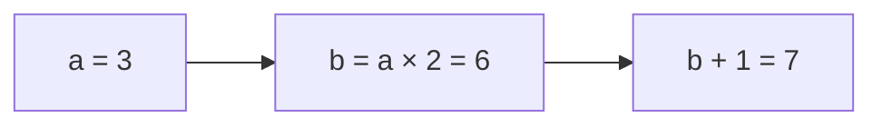

# 1. Pipes and functions

You only need `fwp` installed and a terminal for this lesson. Run the commands
from the repository root. A `.fwp` file contains definitions; `name = expression`
gives a name to a value or function. Execution begins with `main`.

## The pipe

Start with this function, taken from the complete program below:

```fwp
double = mul 2
```

`mul` multiplies numbers. `mul 2` is a function waiting for the number to double.
`5 | double` gives `10`: `|` sends the value on its left to the function on its
right. A pipe between two functions creates a new function that runs them in
order:

```fwp
ten = 5 | double
quadruple = double | double
```

Thus `ten` is a number, while `quadruple` is a function. The latter doubles an
input and doubles the result again. `3 | quadruple` gives `12`.

## One argument at a time, with the input last

Every function takes one argument. Its result can be another function:
`mul 2` returns a function that multiplies its input by two. `mul 2 5` means
`(mul 2) 5`, giving `10`. This way of expressing successive arguments is called
**currying**. Supplying only some arguments is **partial application**; `mul 2`
is an example. The input to transform comes last (**data-last**), so `10 | sub 1`
means `10 - 1`, and `"hello" | concat "!"` gives `"hello!"`.

A definition such as `double = mul 2` never names its input. This style is called
**tacit** programming. It uses ordinary functions; it does not add a special
runtime mechanism. Parentheses group a function or expression used as one
argument, as in `map (mul 2)`.

## Arithmetic expressions

You can also write arithmetic between values: `2 + 3 * 4` gives `14`.
Multiplication (`*`), division (`/`) and remainder (`%`) bind more tightly than
addition (`+`) and subtraction (`-`). Parentheses change that grouping:
`(2 + 3) * 4` gives `20`. Operators at the same level group left to right, so
`20 - 6 - 2` gives `12`.

Arithmetic binds more tightly than a pipe: `2 + 3 * 4 | echo` prints `14`.
Function calls bind more tightly than arithmetic: `double 3 + 1` gives `7`,
while `double (3 + 1)` gives `8`. Prefix functions remain useful for tacit
code: `map (add 1)` adds one to each list element.

Write spaces around subtraction: `x - 1`. Hyphenated names such as `count-long`
remain identifiers, and `add -1` still means adding negative one.
`-(2 + 3)` negates the whole sum. These forms use the same numeric types and
overflow checks as the prefix functions.

## Name an input: `fn`

`fn x -> x * x` makes a function that names its input `x` and squares it.
For example, `3 | (fn x -> x * x)` gives `9`.

```fwp
energy : I64 -> I64
energy = fn x -> let square = x * x in square + square
```

`I64` means a signed 64-bit integer. `I64 -> I64` says the function takes one
integer and returns one. Read the body using the next rule.

## Name a calculation: `let … in …`

**The whole construct is `let name = value in body`. Each `let` has one `in`.**
The small expression traces below can be tried in the REPL; the complete program
at the end prints the same binding, nesting and shadowing results.

```text
let square = 3 * 3 in square + square
```

| Part | What happens |
|---|---|
| `let square = 3 * 3` | Calculate `9` once; give it the name `square`. |
| `in` | Separate that definition from the expression using the name. |
| `square + square` | Add `9 + 9`; the complete expression has value `18`. |

`in` does not mean “output,” return early, or send a value through a pipe.
The **body** is the expression after it. Here is a `let` inside a larger sum:

```text
10 + (let x = 3 in x + x)
= 10 + (3 + 3)
= 16
```

Thus `energy 3` and `3 | energy` both give `18`. They calculate the square once,
then add that saved value to itself.

### Several calculations in order

The body can itself be another `let`:

```text
let a = 3
in let b = a * 2
in b + 1
```



- First `let`/`in`: define `a`; continue with the whole `let b … in …` expression.
- Second `let`/`in`: define `b`; continue with `b + 1`.
- Result: `7`. `in let` is two adjacent keywords, not a separate construct.
- Newlines help reading. The same expression fits on one line; `in` is still required.

Compare these equivalent small calculations:

| Local name | Pipe with a named input | Result |
|---|---|---|
| `let x = 3 in x + x` | `3 \| (fn x -> x + x)` | `6` |
| `let x = 3 in x + 1` | `3 \| add 1` | `4` |

The pipe applies a function. The complete `let … in …` names a value within
its body; `in` alone is not a pipe.

### Where a name is available

A name's **scope** is the expression where it can be used. Parentheses delimit
that expression: `(let x = 3 in x + 1) * 2` gives `8`.

- Bindings are immutable: there is no assignment that changes `x`.
- **Shadowing** makes a new binding with the same spelling:
  `let x = 3 in let x = x + 1 in x` gives `4`.
- The second initializer uses the outer `x`; the second body uses the new `x`.
- An unused initializer still runs. `let _ = print "hello" in 7` prints once
  and produces `7`; `_` discards the printing operation's result.

## Functions that ignore or remember an input

`const 7` and `fn _ -> 7` both ignore their input and return `7`.
When constructing a function, the timing of a calculation matters:

| Expression | When `calculate ()` runs |
|---|---|
| `const (calculate ())` | Once, when constructing the function. |
| `fn _ -> calculate ()` | Each time the function is called. |

Successive inputs remain nested single-argument functions:
`fn amount -> fn value -> value + amount`. Supplying `3` returns a function
that remembers `amount = 3`; supplying `5` to that function produces `8`.
A remembered value is a **capture**. Captures follow ordinary ownership rules;
using a name does not itself require a heap allocation.

## Sending one input to several functions

A **combinator** connects other functions. Keep these when they make a pipe easy
to read; use names when a formula is clearer that way.

| Function | Meaning |
|---|---|
| `id` | Return the input unchanged. |
| `both f g` | Run both functions on the input and return their results as a pair. |
| `fork f g h` | Run `g` and `h`, then pass their results to `f`, in that order. |
| `flip f` | Exchange the first two successive arguments. |
| `tap f` | Run `f`, then return the original input. |
| `const value` | Return a function that ignores its input and returns `value`. |

`length` counts a list and `sum` adds it. For `[3, 5, 10]`, `both length sum`
returns `(3, 18)`, a two-value **tuple**. `average = fork div length sum` gives
`6`: data-last `div 3 18` means `18 / 3`.

A tuple is one argument. `curry` converts a pair-taking function to successive
arguments; `uncurry` converts back. For example, `sum-pair = uncurry add` takes
`(2, 3)` and returns `5`; `sum-curried = curry sum-pair` accepts `2` and then `3`.
The compiler never implicitly unpacks a tuple passed to an ordinary function.

`const 7` is a function; `7` is a number. `[1, 2, 3] | map (const 7)` gives
`[7, 7, 7]`. `map 7` is a type error. Here `const` means “constant function,”
not an immutable binding declaration. It may also return a function:
`const (add 1)` ignores one input and returns `add 1`, which still needs a number.
[Lesson 4](../04-effects/README.md) uses this when updating handled state.

## The complete program

Square brackets make a list. Its elements run left to right; `ignore` discards
the resulting list. `echo` prints a value, `print` prints a string without quotes,
and `upper` changes a string's letters to uppercase.

[`main.fwp`](main.fwp):

```fwp
double = mul 2

ten = 5 | double

quadruple = double | double

decrement = sub 1

energy : I64 -> I64
energy = fn x -> let square = x * x in square + square

average = fork div length sum

sum-pair : (I64, I64) -> I64
sum-pair = uncurry add

sum-curried : I64 -> I64 -> I64
sum-curried = curry sum-pair

main = [
    ten | echo,
    3 | energy | echo,
    (let a = 3 in let b = a * 2 in b + 1) | echo,
    10 + (let x = 3 in x + x) | echo,
    (let x = 3 in let x = x + 1 in x) | echo,
    3 | quadruple | echo,
    10 | decrement | echo,
    [3, 5, 10] | average | echo,
    [3, 5, 10] | both length sum | echo,
    (2, 3) | sum-pair | echo,
    3 | sum-curried 2 | echo,
    "pipes" | upper | concat "!" | print,
] | ignore
```

Run `fwp run docs/tutorials/01-pipes-and-functions/main.fwp` from the repository
root. It compiles and caches native code. Add `--interp` to interpret instead.
The added binding examples print `7` (chained names), `16` (a nested sum),
and `4` (shadowing). Expected [`main.out`](main.out):

```
10
18
7
16
4
12
9
6
(3, 18)
5
5
PIPES!
```

Next: [Data](../02-data/README.md) · [All tutorials](../README.md)
