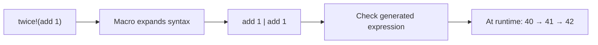

# 11. Compile-time code and macros

Read lessons 1–4 first. **Compile time** is when fwp checks and builds your
program; **runtime** is when the resulting program executes. Reflection means
inspecting a type as data. A macro transforms syntax before the expanded program
is checked. Its own implementation is type-checked first, then run by the
compiler. A syntax tree records how expressions are nested. These tools are useful for generating repetitive
code, but ordinary functions are simpler when no syntax transformation is needed.

`comptime e` evaluates `e` while the program is compiled and puts the
result into the program as a constant. Lists, maps, records and even
functions can be constants. The code inside `comptime` may read files and
fail, but it has no access to the network or tasks.
Return the file's contents, not its open handle: `comptime (file.read "data.txt")`
embeds text, while `comptime (file.open "data.txt")` is rejected. An open handle
belongs to the compiler process and cannot be embedded in the finished program,
even inside a container or function capture.

## Choose the operation by what you need

| Need | Construct | Example |
|---|---|---|
| Calculate a value during compilation | `comptime` | `comptime (2 + 3)` embeds `5`. |
| Inspect a type | `type[T]` | `type[Order]` describes the fields of `Order`. |
| Generate an expression | `quote` and a macro | `twice!(add 1)` produces `add 1 | add 1`. |



## Reflection

`type[T]` describes a type: its name, its type arguments, and its fields or
variants. Together with `comptime`, it can derive things such as schemas or
serializers from a type definition.

## Macros

Programs are data too. `quote e` is the syntax tree of `e`, as a value of
the ordinary type `Syntax`. A macro is a function from syntax to syntax.
Call it with `name!(...)`; its returned syntax becomes part of the program:

```fwp
macro twice = quote (unquote!(0) | unquote!(0))
```

`unquote!(0)` stands for the macro's first syntax argument; indices range from
0 to 63. `unquote!(expression)` instead evaluates an expression producing Syntax.
That computation runs once when the quote/template is built, including when the
template also has positional placeholders. Calling the template does not repeat
it.

A nested `quote` has its own placeholders; its code stays data until that
quote is evaluated. Resolved names in
a quote refer to their definition module; spliced argument names keep their
caller spelling. Local binders introduced inside a quote have fresh identities,
so `quote (let x = 100 in unquote!(0))` cannot capture an argument's unrelated `x`.

This protection is called **hygiene**. Constructing `SName "x"` directly asks for
that spelling; it does not obtain a fresh binding automatically.

`SLambda pattern body` and `SLet pattern value body` represent named functions
and local bindings. `PName "x"` binds a name, `PIgnore` discards an input and
`PRecord` stores field patterns. `PHole` keeps the forwarding meaning used by
`match`; it is rejected in generated fn/let patterns. Generated patterns receive
the same duplicate-name and irrefutability checks as parsed source.

The macro receives parsed syntax, so it cannot add new operators or change
precedence. Its generated expression is type-checked after expansion.
`twice!` duplicates the supplied function's execution, including any effects;
use an ordinary function when syntax transformation is unnecessary.

The prelude defines two macros. `assert!(e)` checks a condition and
reports the failing expression. `dbg!(e)` prints an expression with its
value.

## Reading the example

`squares` precomputes squares of 0 through 9. `commands` is a compile-time map
whose values are functions. `run` names its two successive inputs, looks up the
command once, then applies that local function to the text. For an unknown name, `const "unknown command"`
creates a function with the same input type that ignores the supplied text.

`type[Order]` returns type metadata; matching `ShapeRecord` exposes its fields,
and `map .name` extracts their names. `twice!(add 1)` expands to two `add 1`
stages, so `40 | add-two` prints 42. `assert!` checks a condition and returns unit
`()`, which explains the final output. A schema describes allowed data; a
serializer converts values to text/bytes. Reflection can help generate either.

## The program

[`main.fwp`](main.fwp):

```fwp
squares = comptime (range 0 10 | map (fn x -> x * x))

commands : Map[String, String -> String]
commands = comptime ([
    ("shout", upper),
    ("reverse", string.reverse),
    ("size", string.length | show),
] | map.from-list)

run : String -> String -> String
run = fn name -> fn text ->
    let command =
        commands | map.get name | option.unwrap-or (const "unknown command")
    in command text

Order = { id: I64, item: String, quantity: U32 }

field-names = comptime (type[Order] | .shape | match
    ShapeRecord -> map .name
    _ -> const [])

macro twice = quote (unquote!(0) | unquote!(0))

add-two = twice!(add 1)

main = [
    squares | echo,
    "pipes" | run "shout" | print,
    "pipes" | run "reverse" | print,
    "pipes" | run "fly" | print,
    field-names | echo,
    40 | add-two | echo,
    assert!(1 | add-two | eq 3) | echo,
] | ignore
```

Run it with `fwp run docs/tutorials/11-comptime-and-macros/main.fwp` (compiled to native code and cached), or
build an executable with `fwp build docs/tutorials/11-comptime-and-macros/main.fwp -o comptime-and-macros`. The output is
[`main.out`](main.out):

```
[0, 1, 4, 9, 16, 25, 36, 49, 64, 81]
PIPES
sepip
unknown command
["id", "item", "quantity"]
42
()
```

Programs that inspect or build syntax directly can match on the `Syntax`
constructors (`SInt`, `SName`, `SApply`, `SPipe`, ...), which are defined in
`lib/prelude.fwp`.
The [compiler pipeline](../../compiler-pipeline.md) explains the implementation,
expansion-round limit, compile-time effects and parser classification.

---

Previous: [WebAssembly](../10-webassembly/README.md) · Next: [Numerics](../12-numerics/README.md) · [All tutorials](../README.md)
