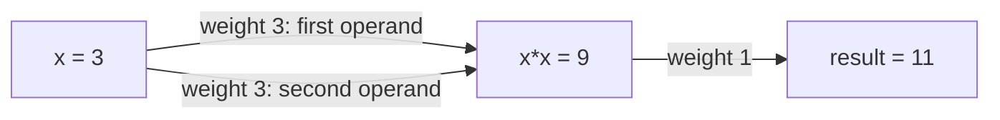

# 20. Reverse-mode autodiff and devices

Read lessons 3 and 12 first. Automatic differentiation calculates derivatives
by applying the derivative rule for each arithmetic operation. Forward mode
carries a derivative alongside each value. To get all partial derivatives of a
scalar result, the `gradient` helper repeats that process for each input.

**Reverse mode** records operations and their dependencies in a **tape**. After
computing the result, it walks those records backward, accumulating how each
input influences that result. `Rev[T]` is the tracked numeric value; `grad f xs`
returns the gradient. This takes one forward and one backward pass for a scalar
result, but those passes store records, allocate memory and do extra arithmetic.
It is not a promise that a gradient costs the same as evaluating `f` once.
Floating-point rounding applies in both modes.

`grad` and `vjp` create a tape scope for each call and release its temporary
records when the call ends. A tracked `Rev` value belongs to that scope; it
cannot be used afterward or moved to another task for calculation. Return the
ordinary result or derivative values instead. Nested gradients use enclosing
tapes without extending the lifetime of an expired inner tape.

`value-and-grad` returns the function value as well. A vector-Jacobian product
(`vjp`) weights several output derivatives by caller-supplied weights; the
Jacobian is the table of derivatives of every output with respect to every input.
Those operations are described in the [numerics guide](../../numerics.md).

The program's `rosenbrock` sums `100(y − x²)² + (1 − x)²` over adjacent
pairs. `zip (drop 1 values)` pairs each value with its successor; `fn (x, y)`
names the pair. Generic trait requirements allow ordinary or tracked numbers.
`descend` subtracts `0.001 * gradient` from the inputs. This decreases the
objective in this example, not necessarily for an arbitrary function.

The descent loop keeps `(steps-left, weights)`:

- `both (const 199) id` supplies the count and keeps the starting weights.
  `const 199` ignores its input; `id` returns its input.
- `.0` selects the count; `.1` selects the weights.
- `Again` carries the next pair; `Stop` returns the final weights.

There are exactly 199 updates, without retaining earlier vectors. Use
`iterate 200 descend` instead when the 200-point history (including the start)
is needed for a plot. [History removal](../../design.md#other-selected-transformations)
can optimize eligible consumers that need only the last value.

## Use the structure of the calculation

An **objective** is the scalar function being differentiated. These three
shapes need different amounts of work:

| Shape | Example | What affects one input's derivative? |
|---|---|---|
| Independent | Sum `(x*x-1)^2` over inputs | Just that input's term |
| Neighbors | Sum `(y-x)^2` over adjacent pairs | At most two pairs |
| Dense | Square and sum matrix-row products | Potentially every row |

The program below first computes the independent objective's gradient at
`[-2, 0, 2]` in four ways. Each computes `[-24, 0, 24]`; the local method
prints the middle zero as `-0.0`. The scalar derivative is `4*x*(x*x-1)`, so the first component is
`4*(-2)*(4-1) = -24`. IEEE floating-point arithmetic has signed zeros:
the scalar derivative here preserves a negative zero, while adding contributions
to an initial positive zero produces `0.0`. Those zeros compare equal; the
methods are not promised to produce identical bits.

- `grad independent` records the whole objective and propagates backward.
- `gradient independent` evaluates it once for each input direction.
- `array.map (derivative loss)` differentiates each independent term once.
  `array.from-list` and `array.to-list` convert the input/output containers.
- Tensor AD differentiates elementwise expressions. `loss` uses its input four
  times, so `tensor.grad-on Cpu` returns four contribution vectors. Convert
  them to lists, then `fold (zip-with add)` adds corresponding coordinates,
  starting from three zeros. Taking only the first vector would be incorrect.

These methods perform equivalent mathematics with different storage and work.
The example checks answers; it does not establish a speed ratio.

For neighbors `[1, 3, 4]`, the squared-edge objective is
`(3-1)^2 + (4-3)^2 = 5`. The edge derivatives are `[-4, 4]` and `[-2, 2]`;
the shared middle input receives both contributions, giving `[-4, 2, 2]`.
Mapping a one-input derivative cannot account for that coupling. A local-pair
helper is still [experimental](../../numerics.md#forward-mode).

For a dense matrix objective, every coordinate may influence every term;
keep the general gradient operations. Current tensor AD supports elementwise
arithmetic, not differentiation through general matrix multiplication.
The [method comparison](../../measurements/structured-autodiff.md) defines the
complete-gradient measurements and these limits; the
[results](../../measurements/structured-gradient-methods-2026-11-08/README.md)
separate supported speed comparisons from inconclusive timings.
The [compiler comparison](../../measurements/structured-array-callbacks-2026-11-08/README.md)
shows what removing temporary derivative objects changes, with allocation counts,
computation time and remaining measurement limits reported separately.

## What the tape records: a smaller example

Before the Rosenbrock program, consider `f(x) = x*x + 2` at `x = 3`.
A **node** identifies a recorded value. An edge says which earlier value it used;
its **weight** is the local derivative for that use.



| Backward step | Contribution |
|---|---|
| Seed the result | `1`: differentiate the result with respect to itself. |
| Through addition of 2 | Multiplication result receives `1 × 1 = 1`. |
| Through the two uses of `x` | `x` receives `1 × 3 + 1 × 3 = 6`. |

The derivative is `6`; the function value is `11`. The accumulated derivative
at a node is its **adjoint**. The tape retains dependencies and weights until
this backward pass finishes. A [complete runnable example](../../terminology.md#derivatives-and-tapes)
and a worked multi-output `vjp` explain the remaining notation.

The program below uses the same process for many operations. Its two local
bindings inside `rosenbrock` mean:

```text
let distance = y - x*x
in (let offset = 1 - x
    in distance*distance*100 + offset*offset)
```

Parentheses above show nesting. Both local names are available in the final
formula; each initializer runs once per adjacent pair.

## Expressions and execution devices

A tensor expression describes arithmetic over an array. `tensor.lazy` creates
an input expression; applying `soft` builds the expression `ln(exp(x) + 1)`.
Building this description does work, but does not yet evaluate every element.
`tensor.sum-on` evaluates and sums it on a selected device. A **kernel** here
is an instruction array evaluated by compiled CPU loops for each element. Combining
the operations into that loop avoids arrays for intermediate `exp` and `add`
results.

`Cpu` uses one CPU thread; `CpuParallel 4` permits up to four. CPU sums add blocks of
4096 elements in a fixed order and then add the block sums in order, so changing
the thread count does not change that addition order. The test below compares
both results; it does not benchmark their speed. `tensor.grad` builds derivatives
of the sum with respect to each input leaf; the sample prints the first two
elements of each resulting gradient vector.

Worker limits must be between 1 and 256. `device.available (CpuParallel 4)`
returns `True`; a limit of 0 or 257 is invalid and traps when used. Small kernels
use fewer workers; WebAssembly executes serially. GPU execution is not supported.

## The program

[`main.fwp`](main.fwp):

```fwp
rosenbrock : List[t] -> t where Ring[t], FromFloat[t], Dup[t]
rosenbrock = fn values ->
    values
    | zip (drop 1 values)
    | map (fn (x, y) ->
        let distance = y - x * x
        in let offset = 1.0 - x
        in distance * distance * 100.0 + offset * offset)
    | sum

descend : List[F64] -> List[F64]
descend = fn values ->
    let adjustment = grad rosenbrock values | map (mul 0.001)
    in values | zip-with sub adjustment

loss : t -> t where Ring[t], FromFloat[t], Dup[t]
loss = fn value -> let residual = value * value - 1.0 in residual * residual

independent : List[t] -> t where Ring[t], FromFloat[t], Dup[t]
independent = map loss | sum

soft : t -> t where Field[t], Floating[t], FromFloat[t]
soft = exp | add 1.0 | ln

xs : Vector[F64, _]
xs = 1000 | range 0 | map (int.to-float | mul 0.01 | sub 5.0) | vector.from-list

main = [
    [-2.0, 0.0, 2.0] | grad independent | echo,
    [-2.0, 0.0, 2.0] | gradient independent | echo,
    [-2.0, 0.0, 2.0]
    | array.from-list
    | array.map (derivative loss)
    | array.to-list
    | echo,
    [-2.0, 0.0, 2.0]
    | vector.from-list
    | tensor.lazy
    | loss
    | tensor.grad-on Cpu
    | map vector.to-list
    | fold (zip-with add) [0.0, 0.0, 0.0]
    | echo,
    [-1.2, 1.0, 0.5] | grad rosenbrock | show | print,
    [-1.2, 1.0, 0.5] | gradient rosenbrock | show | print,
    [-1.2, 1.0, 0.5]
    | both (const 199) id
    | loop
        (if (.0 | eq 0) (.1 | Stop) (both (.0 | sub 1) (.1 | descend) | Again))
    | rosenbrock
    | show
    | print,
    xs | tensor.lazy | soft | tensor.sum-on (CpuParallel 4) | show | print,
    xs | tensor.lazy | soft | tensor.sum-on Cpu | show | print,
    xs
    | tensor.lazy
    | soft
    | tensor.grad
    | map (vector.to-list | take 2)
    | show
    | print,
] | ignore
```

Run `fwp run docs/tutorials/20-autodiff-and-devices/main.fwp`.
Expected [`main.out`](main.out):

```
[-24.0, 0.0, 24.0]
[-24.0, 0.0, 24.0]
[-24.0, -0.0, 24.0]
[-24.0, 0.0, 24.0]
[-215.59999999999997, 112.00000000000001, -100.0]
[-215.59999999999997, 112.00000000000001, -100.0]
3.493467774689583
1410.6489026879174
1410.6489026879174
[[0.006692850924284856, 0.006759660510713249]]
```

The expected output checks interpreter/native agreement for this program,
including the sums of its parallel CPU kernels. [docs/numerics.md](../../numerics.md) describes
the tape, the kernels and the devices.

---

Previous: [WebSockets and HTTP/2](../19-websockets-and-http2/README.md) · Next: [MCP tools](../21-mcp/README.md) · [All tutorials](../README.md)
